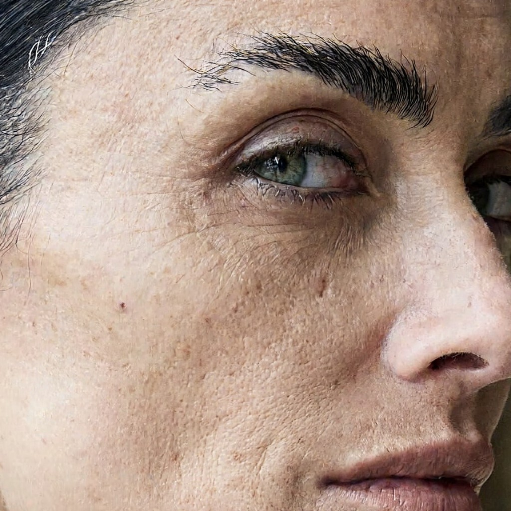
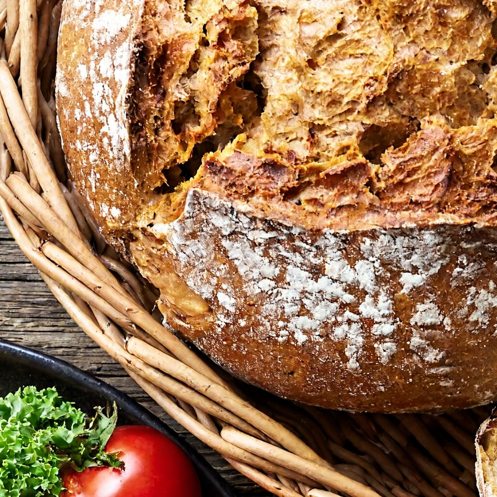

# MiniMax-H3-Image for MLX


Run [MiniMax-H3-Image](https://huggingface.co/MiniMaxAI/MiniMax-H3-Image) on Apple Silicon. It is MiniMax's 33B,
16-megapixel, 6-step model for text-to-image and image editing. This is a faithful [MLX](https://github.com/ml-explore/mlx) port:
- the same arithmetic as the reference implementation;
- the exact bf16 weights, streamed from the SSD block by block;
- about 5 GB of memory at 4 megapixels.

Unofficial, and not affiliated with MiniMax. **Powered by MiniMax-H3-Image.**

| | |
|---|---|
| Weights | [VisualInference/MiniMax-H3-Image-MLX-bf16](https://huggingface.co/VisualInference/MiniMax-H3-Image-MLX-bf16): 94 GB, gated (accept the licence; approval is automatic) |
| 4736×3552 (16.8 MP), M4 Pro Mac mini | ~17 min, 14.7 GB peak memory |
| 2048×2048 (4 MP) | 3.2 min, 5.2 GB peak (4.6 GB with `--cache-limit-gb 1`, identical pixels) |
| Fidelity | float32 matches the PyTorch reference; bf16 is as close to it as PyTorch's own backends are; MiniMax's published seed-42 image reproduces |

## Install

```bash
pip install git+https://github.com/felix-ab/minimax-h3-image-mlx
```

The weights are gated. First accept the licence on the
[model page](https://huggingface.co/VisualInference/MiniMax-H3-Image-MLX-bf16), then log in once:

```bash
hf auth login
```

## Generate

```bash
minimax-h3-mlx @prompt.txt --size 4736x3552 --seed 42 -o out.png
```

The first run downloads the bf16 tier (94 GB). Sizes below 4 MP are generated on a 4 MP canvas and resized, as
MiniMax's own pipeline does; `--min-generation-area 1024` turns that off.

Edit one or more reference images, which the prompt refers to as `<Picture 1>`, `<Picture 2>`, and so on:

```bash
minimax-h3-mlx @edit.txt --image ref.png --size 4096x4096 --seed 1234 -o edit.png
```

From Python:

```python
from minimax_h3_mlx.pipeline import Pipeline
from minimax_h3_mlx.weights import resolve

pipe = Pipeline(resolve("bf16"))
result = pipe(open("prompt.txt").read(), height=3552, width=4736, seed=42)
result.image.save("out.png")
```

MiniMax-H3-Image wants long, complete English descriptions of the whole image; see `examples/prompts/`. MiniMax's
[prompt expander](https://huggingface.co/MiniMaxAI/MiniMax-H3-Image-PE) writes them from short requests.

## Same seed, same picture


The model card's own example (`examples/revised_prompt.t2i.txt`, seed 42, CPU generator, 4736×3552), next to the
render MiniMax publishes from their local SGLang server. It shows the same objects in the same places under the same
light. Fine detail differs, as it does between any two bf16 implementations of this model (see below).


Editing works the same way: MiniMax's edit example (`reference1.png`, seed 1234, 4096×4096), with their result in the
middle and this port's on the right.

## How it is built

- **Exact AdaLN tables.**
  - Each transformer block's AdaLN projection depends only on the timestep, and the distilled sampler only ever
    uses 7 timesteps.
  - So the 13 B projection parameters (26 GB) are replaced by their outputs, computed in float64 and rounded
    once to bf16.
  - The bf16 transformer drops from 66 GB to 40 GB without changing a single result.
- **A truncated text encoder.** The model reads `hidden_states[50]` of its Qwen3-VL text encoder, so layers 50–63
  and the LM head are not shipped. The vision tower is kept for editing.
- **Streaming.**
  - At these resolutions the transformer is compute-bound: ~150 s per step at 16 MP on an M4 Pro.
  - Each 0.77 GB block is read from the SSD while the previous one computes, which costs almost nothing.
- **Bit-exact noise.**
  - `torch.randn` on the CPU generator is reproduced exactly, including the `__sincosf_stret` calls clang emits on
    macOS.
  - Seeds therefore match MiniMax's pipelines.
- **The reference's rounding points.**
  - The transformer's RMSNorm rounds once, while Qwen's rounds before the weight.
  - SiLU is computed in float32; biased linears use a single-rounding GEMM epilogue; RoPE tables are rounded to
    bf16 where PyTorch rounds them.
  - MLX's bf16 GEMMs turned out to be bit-identical to PyTorch-MPS at every shape this model uses.

## Validation

[docs/VALIDATION.md](docs/VALIDATION.md) has every number; `validation/` holds the harness that produced them. In
short:

- **float32:** MLX and PyTorch (diffusers / transformers, stock modules) agree. The transformer velocity differs
  by 5e-6, and six denoising steps leave the latent within 3e-5.
- **bf16:** this model is chaotic in bf16, so two correct implementations disagree in fine detail. Against float32
  truth, MLX lands 28.4 dB away on average over four cases, PyTorch-MPS 26.7 dB.

## Why there is no 8-bit tier

An 8-bit transformer and text encoder drew the same pictures, about as close to bf16 as a second bf16 backend is.
But at these resolutions quantized matmuls are slower than bf16 on Apple Silicon. At 2048², 8-bit took 218 s
with 27 GB resident, or 277 s streamed, against 193 s and 5 GB for bf16. It would only shrink the download, so only
the exact weights are published.

## Gallery

Each image is a 16-megapixel render with the bf16 tier on an M4 Pro Mac mini (about 16 minutes), shown downscaled.
The prompts are in `examples/prompts/`.

| | |
|---|---|
|  |  |
|  |  |
|  |  |

1:1 crops of the 16 MP portrait and of MiniMax's seed-42 example:

| | |
|---|---|
|  |  |

All images in this repository are AI-generated with MiniMax-H3-Image.

## Licence

- **Code:** Apache-2.0. It is ported from Hugging Face diffusers and transformers; see NOTICE.
- **Weights:** the [MiniMax-H3-Image Community License Agreement](https://huggingface.co/MiniMaxAI/MiniMax-H3-Image/blob/main/LICENSE),
  including its Acceptable Use Policy. That licence excludes the European Union, the United Kingdom, the Republic of
  Korea and the United States of America from its territory unless MiniMax grants separate authorization.
