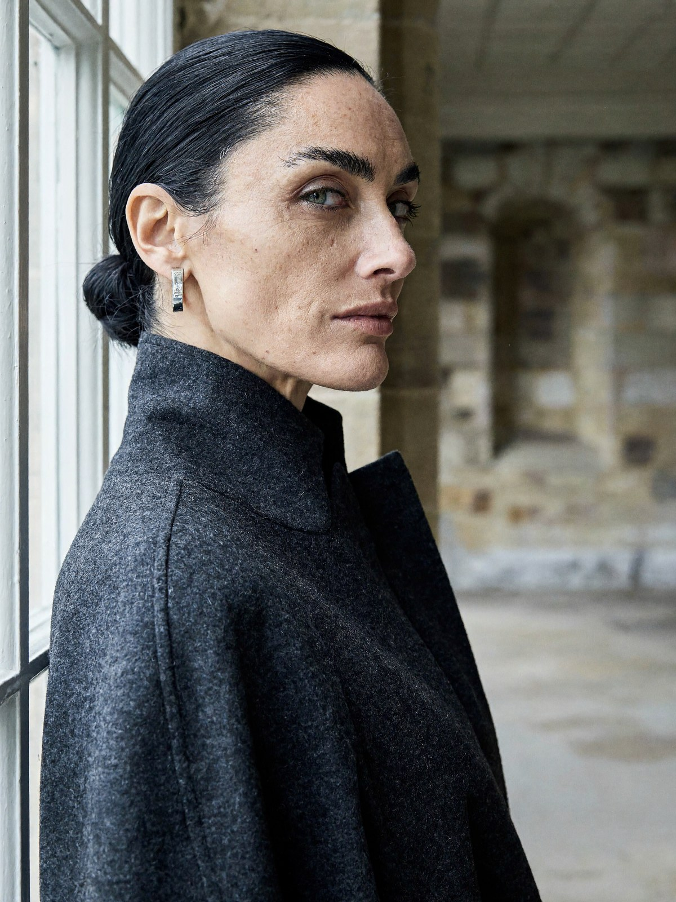

# MiniMax-H3-Image for MLX


[MiniMax-H3-Image](https://huggingface.co/MiniMaxAI/MiniMax-H3-Image) for Apple Silicon. It does text-to-image and image
editing with a 33B model, at up to ~16 MP, in 6 steps. Weights:
[VisualInference/MiniMax-H3-Image-MLX-bf16](https://huggingface.co/VisualInference/MiniMax-H3-Image-MLX-bf16). Unofficial
and not affiliated with MiniMax. Powered by MiniMax-H3-Image.

| | |
|---|---|
| Download | 94 GB |
| Memory | 5 GB at 2048×2048, 15 GB at 4736×3552 |
| Time (M4 Pro Mac mini, 48 GB) | 3 min at 2048×2048, 17 min at 4736×3552 |

## Usage

The weights are gated. Accept the licence on the
[model page](https://huggingface.co/VisualInference/MiniMax-H3-Image-MLX-bf16), then:

```bash
pip install git+https://github.com/felix-ab/minimax-h3-image-mlx
hf auth login
minimax-h3-mlx @prompt.txt --size 4736x3552 --seed 42 -o out.png
minimax-h3-mlx @edit.txt --image ref.png --size 4096x4096 --seed 1234 -o edit.png
```

The second command edits `ref.png`; the prompt refers to it as `<Picture 1>`. The first run downloads the weights.
The model expects long, detailed English prompts (see `examples/prompts/`). Sizes under 4 MP are generated at 4 MP
and scaled down, as in MiniMax's pipeline; `--min-generation-area 1024` turns that off. `--cache-limit-gb 1` lowers
memory slightly without changing the output.

From Python:

```python
from minimax_h3_mlx.pipeline import Pipeline
from minimax_h3_mlx.weights import resolve

pipe = Pipeline(resolve("bf16"))
pipe(open("prompt.txt").read(), height=3552, width=4736, seed=42).image.save("out.png")
```

## Accuracy

- **float32:** output matches the PyTorch reference (diffusers / transformers) to within 3e-5 after 6 steps.
- **bf16:** output differs from the reference about as much as PyTorch's own bf16 backends differ from each other.
- **Seeds:** they match MiniMax's pipeline. Their published seed-42 example gives the same image (left: MiniMax,
  right: this port).


The full measurements are in [docs/VALIDATION.md](docs/VALIDATION.md), and the scripts that produce them in `validation/`.

## How it works

- **Weights stay bf16.** Each transformer block (0.77 GB) is read from disk while the previous one computes, so
  memory stays low.
- **AdaLN tables.**
  - Each block's AdaLN projection depends only on the timestep, and the sampler uses 7 timesteps.
  - So the projections (26 GB) are replaced by their precomputed outputs, with identical results.
- **Short text encoder.** It ends after layer 49, because the model only reads `hidden_states[50]`.
- **Noise.** The initial noise is bit-identical to `torch.randn` on the CPU generator.
- **Rounding.** Each op rounds where PyTorch does.

## Why there is no 8-bit version

It gave the same image quality but ran slower on Apple Silicon: 218 s against 193 s at 2048×2048. Unless streamed,
it also needed 27 GB of memory. Its only advantage would be a smaller download.

## Examples

Generated at ~16 MP and shown downscaled. The prompts are in `examples/prompts/`.

| | |
|---|---|
|  |  |
|  |  |
|  |  |

## Licence

- **Code:** Apache-2.0. It is ported from Hugging Face diffusers and transformers; see NOTICE.
- **Weights:** the [MiniMax-H3-Image Community License Agreement](https://huggingface.co/MiniMaxAI/MiniMax-H3-Image/blob/main/LICENSE),
  including its Acceptable Use Policy and territorial restrictions.
- The example images are AI-generated.
